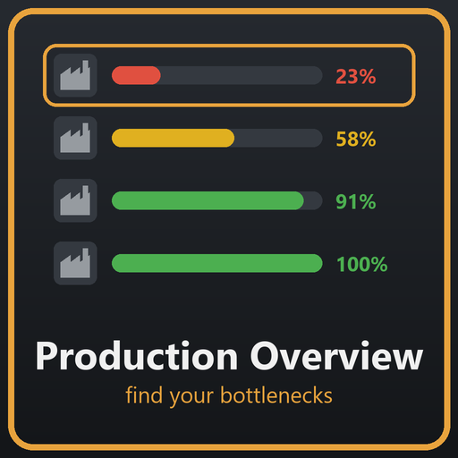

# Production Overview

A mod for [Captain of Industry](https://www.captain-of-industry.com/) that lists every production building with its
efficiency – worst first – so you can find and fix your bottlenecks.



## Features

- Open it from the toolbar or with **F9**.
- Efficiency bar per building, the **main reason for downtime** (missing input, output full, no power, no workers …)
  and the current state.
- Time range: current month, last month, last 3 or 12 months.
- Filters: name/type, below 95 / 80 / 50 %, hide paused buildings, hide "output full" (on by default).
- **Auxiliary buildings** (smoke stacks, flares, burners, ocean dumps – everything the game marks as waste disposal)
  are hidden automatically.
- **By type** tab: average efficiency per building type. Untick a type (e.g. cooling towers) to exclude it everywhere;
  excluded types stay in the list greyed out, so you can tick them again. The choice applies to all saves.
- Hover a row to highlight the building on the map, click it to fly there and open its inspector.
- English and German.

Uses the same productivity statistics as the building inspector. Can be added to or removed from a save at any time.
No network connections.

## Install

Install it from the **CoI Hub** in the game, or download the ZIP from the [Releases](../../releases), extract the
`ProductionOverview` folder into `%APPDATA%\Captain of Industry\Mods` and enable the mod when loading a save.

## Build

Requires the .NET SDK and an installed copy of the game. The project references the game's DLLs from
`C:\Program Files (x86)\Steam\steamapps\common\Captain of Industry\Captain of Industry_Data\Managed`;
pass `-p:GameManaged=<path>` if yours is elsewhere.

```bash
dotnet build ProductionOverview.csproj -c Release
```

The build copies the DLL, manifest and thumbnail into `%APPDATA%\Captain of Industry\Mods\ProductionOverview`.
Restart the game completely after replacing the DLL.

## How it works

`ProductionStatsCollector` reads the productivity counters the game keeps for every building that implements
`IEntityWithProductivityCounter` (machines, labs, reactors, …; conveyors and vehicles are skipped). Efficiency is the
share of productive samples in the selected period, exactly as the inspector's productivity chart computes it.
Excluded types are stored in the player preferences (`ProductionOverview_HiddenTypes`).

## Deutsch

Listet alle Produktionsgebäude mit ihrer Effizienz auf, die schlechtesten zuerst. Öffnen mit **F9** oder über die
Toolbar. Filter für Zeitraum, Schwelle, pausierte Gebäude, „Output voll“ und Hilfsgebäude (Schornsteine, Gasfackeln
usw. werden automatisch ausgeblendet). Im Tab „Nach Typ“ lassen sich einzelne Gebäudetypen per Haken ausschließen.
Klick auf eine Zeile fliegt zum Gebäude.

## Support

The mod is free and stays free. If it saves you time and you want to say thanks, you can buy me a coffee:
**[paypal.me/JoergHilbert](https://paypal.me/JoergHilbert)** – completely voluntary, every feature works without it.

Gefällt dir die Mod? Über eine freiwillige Spende freue ich mich: [paypal.me/JoergHilbert](https://paypal.me/JoergHilbert)

## License

MIT – see [LICENSE](LICENSE). Captain of Industry is a trademark of MaFi Games; this mod is unofficial and not
affiliated with MaFi Games. It contains no game code or game assets.
